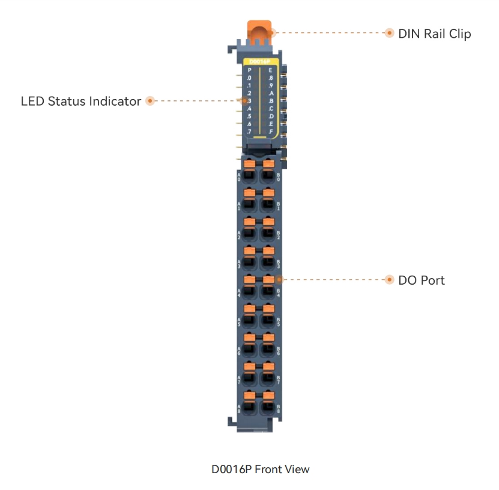
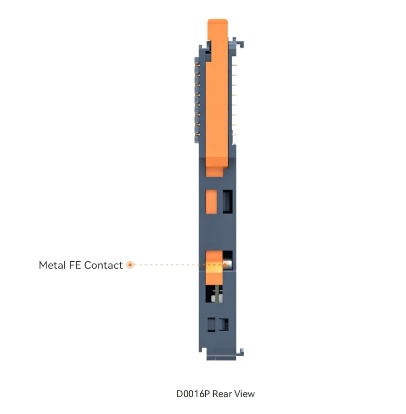
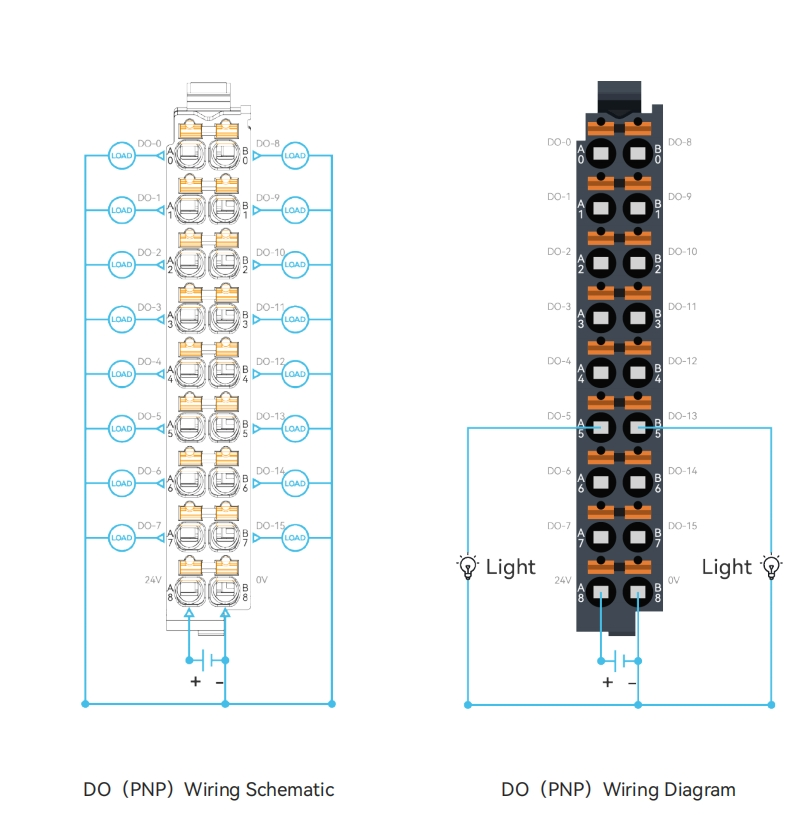
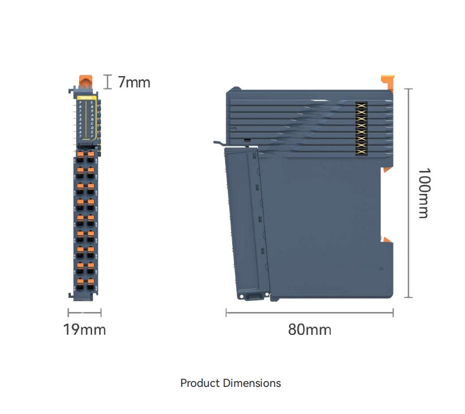

# D0016P – 16-Channel PNP Digital Output Module

## 1. Product Overview

The D0016P is a 16-channel PNP digital output expansion module designed for the IOTRouter EM Series FlowPLC® Edge Computing Gateway.

It provides 16 digital output channels for controlling external devices in industrial automation applications.

The module features full isolation, ESD protection and surge protection. It supports DIN-rail mounting for convenient installation in industrial control cabinets.

### Key Features

- 16-channel PNP digital output
- Maximum output current: 0.5 A per channel
- Maximum total output current: 5 A @ 24 V
- Full isolation
- ESD and surge protection
- DIN-rail mounting
- Operating temperature: -40 to +85 °C

## 2. Technical Specifications

| Parameter | Specification |
|---|---|
| Model | D0016P |
| Number of Channels | 16 |
| Terminal | DO × 16 |
| Output Type | PNP |
| Output Current | Max. 0.5 A per channel |
| Maximum Total Output Current | 5 A @ 24 V |
| Protection | Full isolation, ESD, surge protection |
| Certification | CE |
| Operating Voltage | 5 V |
| Operating Temperature | -40 to +85 °C |
| Storage Temperature | -40 to +85 °C |
| Operating Humidity | 0–95% RH, non-condensing |
| Storage Humidity | 0–95% RH, non-condensing |
| Dimensions | 19 × 100 × 80 mm |
| Enclosure Material | PC |
| Mounting | DIN rail |
| Cooling | Passive |

### EMC Specifications

| Test Item | Specification |
|---|---|
| ESD (Air Discharge) | Level 3, ±8 kV |
| ESD (Contact Discharge) | Level 2, ±4 kV |
| Surge | Level 2, ±1 kV |
| EFT | Level 2, ±1 kV |

## 3. Product Structure

The D0016P module includes the following components:

| Component | Description |
|---|---|
| DIN Rail Clip | Used for DIN-rail installation |
| LED Status Indicators | Display channel status |
| DO Ports | 16 digital output connection channels |
| Metal FE Contact | Functional earth contact |

### 3.1 Front View

The front of the D0016P provides 16 digital output terminals, identified as DO-0 to DO-15, together with LED status indicators for monitoring output channel status.

### 3.2 Rear View

The rear side of the module includes a metal FE contact for functional grounding.

## 4. Wiring Instructions

The D0016P uses PNP digital output wiring and provides 16 output channels, identified as DO-0 through DO-15.

### 4.1 PNP Output Wiring

Refer to the following wiring schematic and wiring diagram for connection details.

### Wiring Notes

- The module provides 16 PNP digital output channels.
- Maximum output current: 0.5 A per channel.
- Maximum total output current: 5 A @ 24 V.
- Check the power supply polarity and terminal connections before operation.
- Ensure that the connected loads comply with the module's output current limits.

Refer to the wiring diagram and actual terminal markings when connecting external devices.

## 5. Installation Instructions

The D0016P supports DIN-rail mounting for installation in industrial control cabinets.

### 5.1 Product Dimensions

| Dimension | Measurement |
|---|---|
| Width | 19 mm |
| Height | 100 mm |
| Depth | 80 mm |

### 5.2 Installation Requirements

- Install the module on a compatible DIN rail.
- Ensure sufficient space for wiring and ventilation.
- Verify terminal connections before powering on.
- Ensure reliable grounding and electrical connections.

The module uses passive cooling.

## 6. Safety and Operating Requirements

### 6.1 Qualified Personnel

Installation, commissioning, operation and maintenance must be performed by qualified personnel.

### 6.2 Grounding

Ensure reliable grounding according to the wiring requirements.

Improper grounding or electrical connections may cause malfunction, data loss or personal injury.

### 6.3 Environmental Conditions

Operate and store the module within the specified temperature and humidity ranges.

Operating and storage humidity must remain between 0 and 95% RH, non-condensing.

### 6.4 Recycling and Disposal

Do not dispose of waste equipment with household waste. Follow local regulations or use a certified electronic waste disposal service.

## 7. Document Information

| Item | Information |
|---|---|
| Product | D0016P |
| Document Type | Product Specification |
| Revision | V1.0 |
| Release Date | May 2026 |
| Manufacturer | Chengdu Zongheng Intelligent Control Technology Co., Ltd. |
| Website | [https://en.iotrouter.com/wp-content/uploads/pdf-down/D0016P_Product_Specification.pdf] |

## 8. Important Notes

- The D0016P is a PNP digital output module.
- The maximum output current is 0.5 A per channel, with a maximum total output current of 5 A at 24 V.
- Check the actual hardware configuration and wiring requirements before installation.
- Product specifications may be updated in future revisions.
