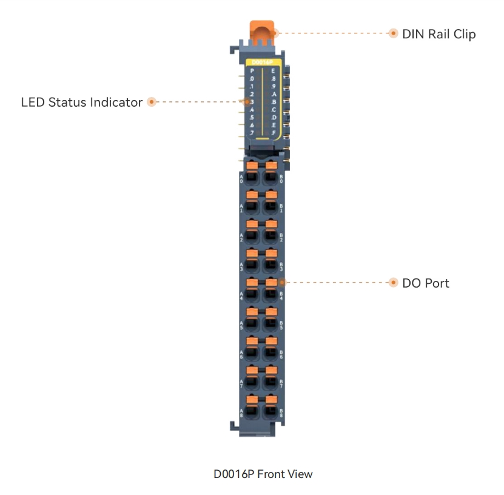
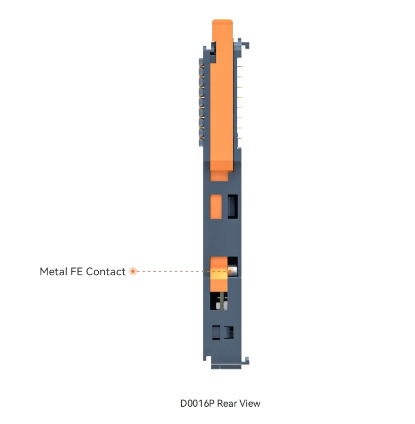
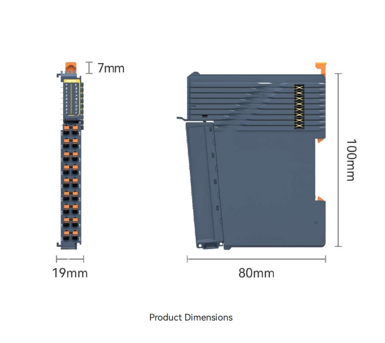
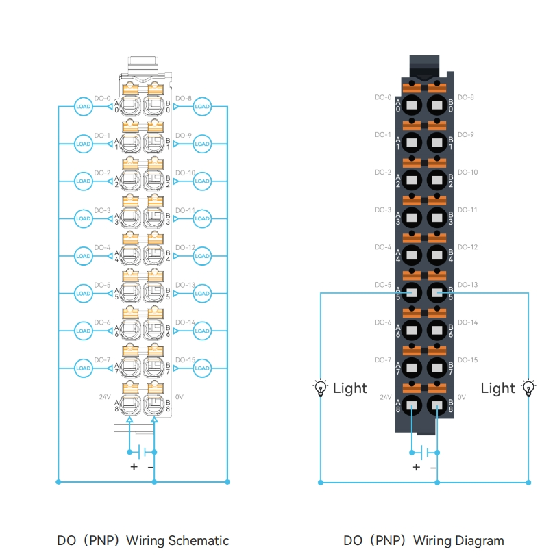

# D0016P – Product Images

This directory contains the product images and technical diagrams for the D0016P 16-Channel PNP Digital Output Module.

## Image List

| Image | Description |
|---|---|
| front-view.png | Front view of the D0016P module |
| rear-view.png | Rear view of the D0016P module |
| dimensions.png | Product dimensions and mechanical drawing |
| wiring-diagram.png | PNP digital output wiring schematic and connection diagram |

## Image Preview

### Front View

### Rear View

### Product Dimensions

### Wiring Diagram

## Related Documentation

For product specifications, electrical parameters, installation instructions and wiring details, refer to:

[D0016P – 16-Channel PNP Digital Output Module](../D0016P.md)

---

**Product:** D0016P  
**Category:** Digital Output Module  
**Manufacturer:** IOTRouter
