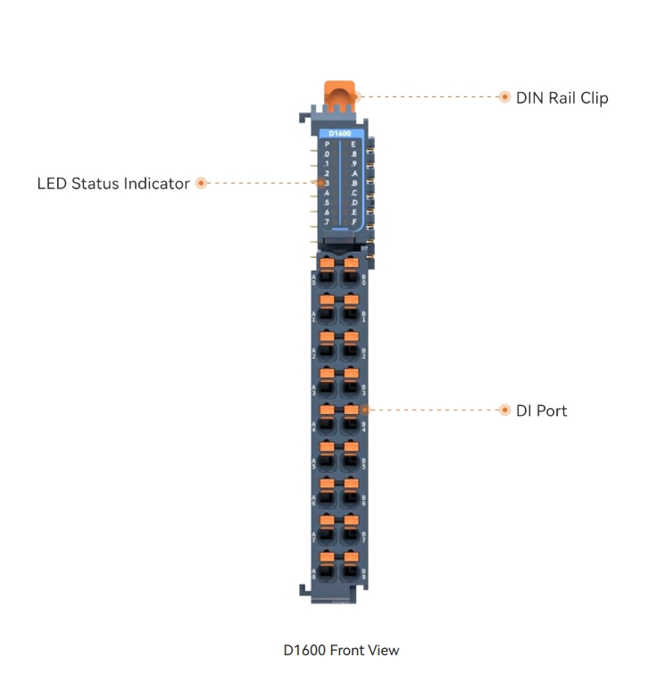
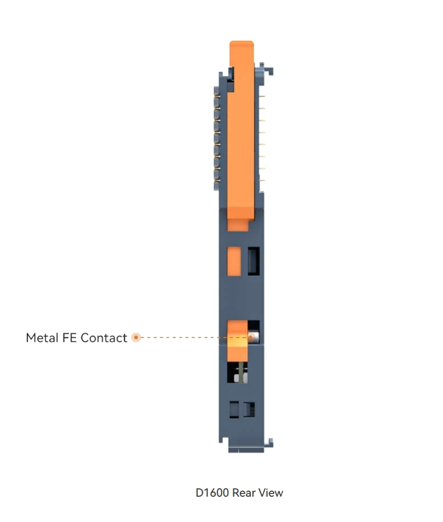
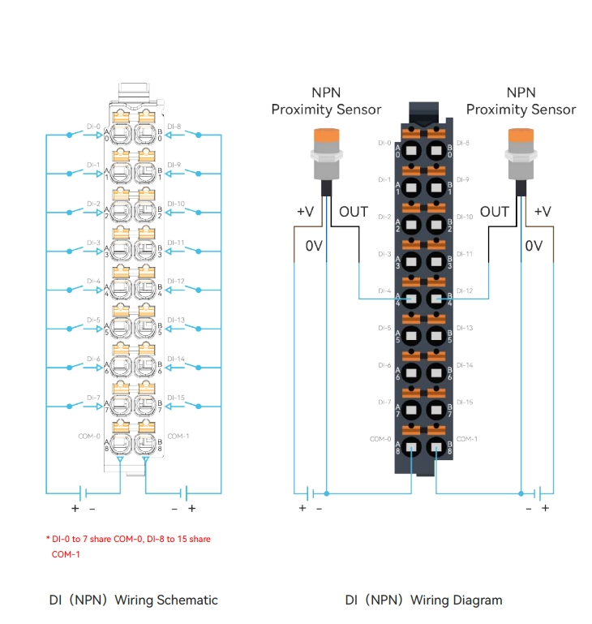
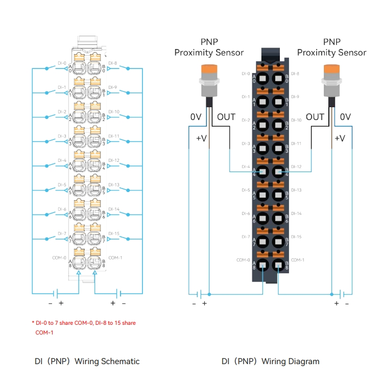
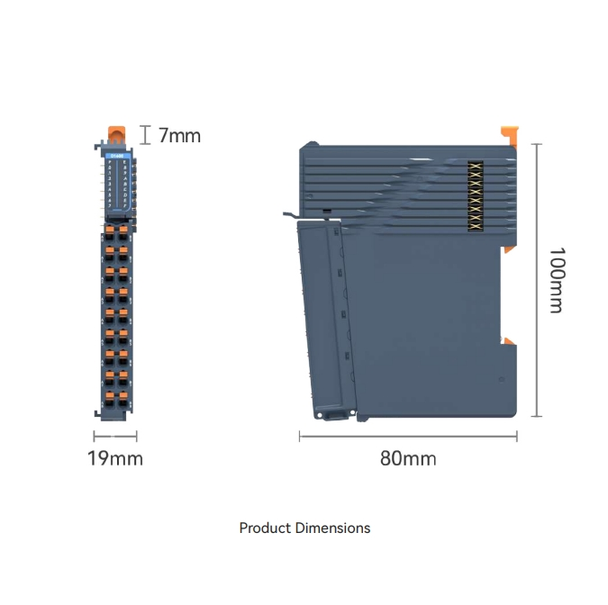

# D1600 – Product Images and Wiring Diagrams

This directory contains product images, wiring diagrams and dimensional drawings for the IOTRouter D1600 16-Channel Digital Input Module.

## Image List

| File | Description |
|---|---|
| `front-view.png` | Front view showing the DIN-rail clip, LED status indicators and DI terminals |
| `rear-view.png` | Rear view showing the metal FE contact |
| `npn-wiring-diagram.png` | NPN digital input wiring schematic and sensor connections |
| `pnp-wiring-diagram.png` | PNP digital input wiring schematic and sensor connections |
| `dimensions.png` | Product dimensions: 19 × 100 × 80 mm |

## Image Preview

### Front View

### Rear View

### NPN Input Wiring

### PNP Input Wiring

### Product Dimensions

## Wiring Notes

- The D1600 provides 16 digital input channels.
- Supports both NPN and PNP input types.
- DI-0 to DI-7 share COM-0.
- DI-8 to DI-15 share COM-1.
- Follow the corresponding NPN or PNP wiring diagram when connecting field devices.

## Related Documentation

[D1600 – 16-Channel Digital Input Module](../README.md)

---

**Product:** D1600  
**Category:** Digital Input Module  
**Document Reference:** D1600 Product Specification V1.0 (May 2026)  
**Manufacturer:** IOTRouter
