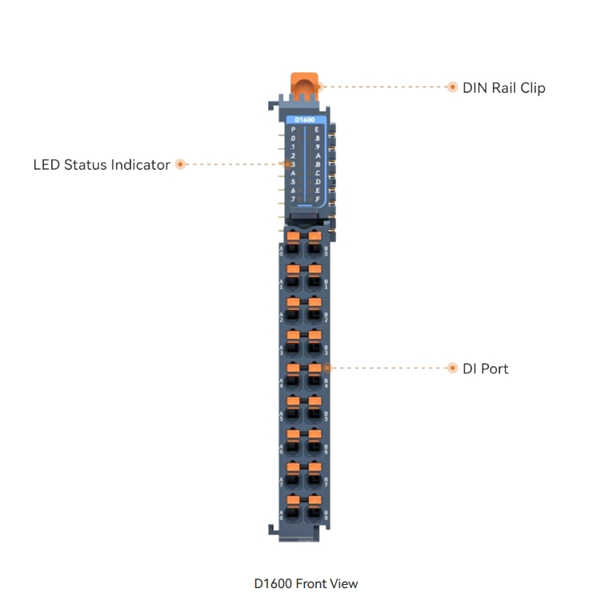

# D1600 – Product Images and Wiring Diagrams

This directory contains product-view, installation-dimension and wiring images from the IOTRouter D1600 Product Specification (V1.0, May 2026).

## Image List

| File | Content |
|---|---|
| `front-view.png` | Front view, including the DIN-rail clip, LEDs and DI ports |
| `rear-view.png` | Rear view and metal FE contact |
| `npn-wiring-diagram.png` | NPN digital input schematic and sensor wiring |
| `pnp-wiring-diagram.png` | PNP digital input schematic and sensor wiring |
| `dimensions.png` | 19 × 100 × 80 mm product dimension illustration |

## Image Preview

### Front View

### Rear View

### NPN Input Wiring

### PNP Input Wiring

### Product Dimensions

## Related Documentation

[D1600 – 16-Channel Digital Input Module](../README.md)

**Note:** DI-0 through DI-7 share COM-0; DI-8 through DI-15 share COM-1. Always follow the relevant NPN/PNP wiring diagram when connecting sensors.
